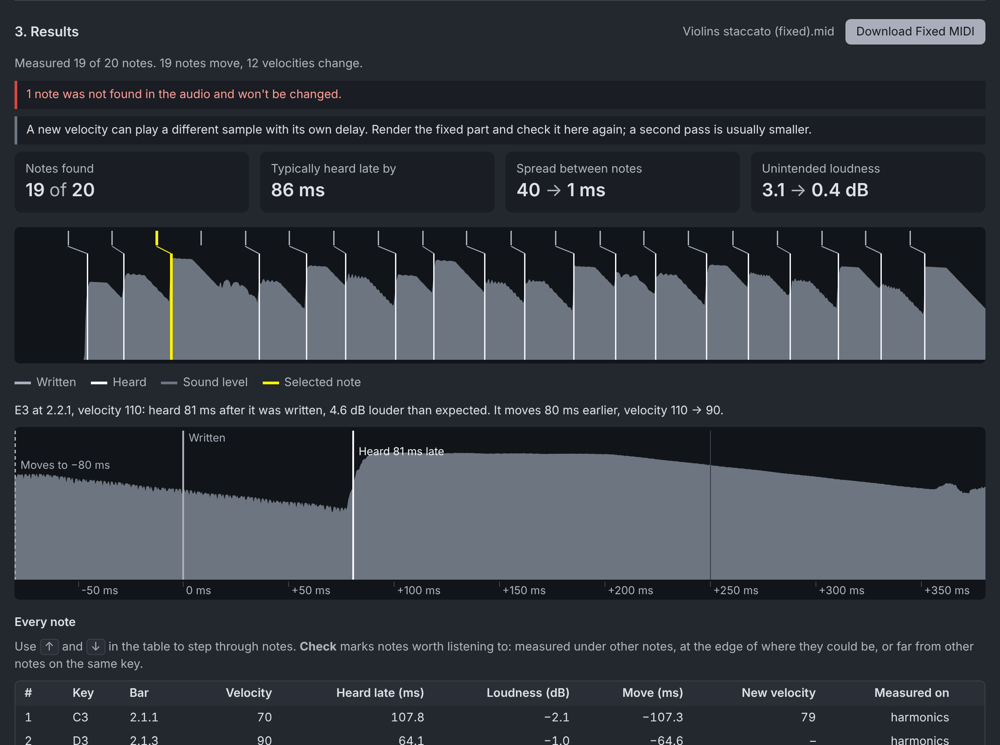

# Note Position & Volume Fixer

Older orchestral sample libraries sound late: the sample starts with the bow
or breath before the note, so the attack is heard 30-150 ms after the MIDI
note - and by a different amount on every key and velocity. Some notes also
come out louder or quieter than their neighbours because of how they were
recorded.

This tool listens to a render of your part, finds where each note is really
heard and how loud it is, and gives you back the MIDI with every note moved
so its sound lands where you wrote it, and velocities (or CC11) changed where
a note was too loud or too quiet. It works with any library and any DAW:
Ableton Live, Cubase, REAPER, Logic, Studio One.

It is one web page that runs on your own computer. Nothing is installed and
no file is uploaded anywhere.



## Use

Open **`Note-Position-Volume-Fixer.html`** in Chrome, Edge, Safari or Firefox
(download it, then double-click it).

### Fix a part from its render

1. In your DAW, export the part as a MIDI file, and render the same part to
   WAV or AIFF from the same starting point. Turn off reverb sends so each
   note is clear. (The page's *How to get the files out of your DAW* section
   has the steps for Live, Cubase and REAPER.)
2. Drop both files on the page. It measures every note.
3. Choose what to fix, look over the results, and press
   **Download Fixed MIDI**. Drag the file back into your DAW where the part
   was.

If you changed velocities, render the fixed part and drop it in again: a new
velocity can play a different sample with its own delay, so a second pass
tidies up what's left.

### Fix any part from a learned profile

Better for chords, legato, fast passages and libraries with round robins.
You do this once per patch:

1. Choose **Measure from: A learned profile**, then open
   **Learn a new profile**. Choose the keys and velocities, type your
   project's tempo, and press **Download Test MIDI**.
2. Put the test MIDI on the instrument, render it from its first bar, and
   drop the render on the page. Name the profile after the patch
   ("Berlin Strings Violins 1 Staccato") and press **Learn Profile**.

After that, any part played on that patch only needs its MIDI file: drop it
in, choose the profile, download the fix. Profiles are kept in the browser;
**Save Profile File…** keeps a copy you can open on another computer.

### What the settings do

| Setting | What it does |
| --- | --- |
| **Move: Each note / Each key / Whole part / Don't move** | Each note uses its own measurement. Each key uses one typical value per key and velocity - steadier when the library cycles round robins. Whole part is the same as one negative track delay. |
| **Line up: The attack / The start of any sound** | Where "the sound" is: when the attack is heard (12 dB below the note's first peak), or the very first sound. |
| **Strength** | How much of the measured difference to correct. |
| **Land after the grid** | Put the sound this many ms after the written note instead of on it. |
| **Even out: Each note / Each key / Off** | Correct loudness differences per note, or one value per key. |
| **Using: Velocity / CC11** | Velocity works for most patches. CC11 suits patches where velocity changes the attack but not the level; it writes one CC11 value per note, so overlapping notes keep using velocity. |
| **Leave alone within** | Differences smaller than this aren't corrected. |
| **dB per velocity step** | How much louder one velocity step makes a note. Left empty, it's worked out from the part. |
| **Played at … BPM** | Live and Cubase play an imported MIDI file at the project's tempo. If yours differs from the file's, type it here. |
| More settings | How late a sound can be, how far notes can differ, audio that starts late, keyswitch range, how to measure, CC11 values, whether note ends move too. |

Keyswitches, program changes and CCs written exactly on a note's start move
with the note, so the articulation still arrives first. A part whose notes
now start before the clip did is moved later by whole bars; the page tells
you how far to move it back.

### What to check

The table marks notes worth a listen (**Check**): measured under other
notes, at the edge of where they could be, or far from other notes on the
same key. Notes it can't find are left alone. Chords are measured as one
attack and moved together.

## What else exists

[`docs/research.md`](docs/research.md) compares this with negative track
delay, Cubase's attack compensation, NTD Engine, Kontakt scripts and the
community delay database, explains how notes are measured, and suggests a
Max for Live device as the next step for Ableton.

## For developers

```sh
npm test            # the engine: 34 checks against a made-up library with known delays
npm run build       # writes Note-Position-Volume-Fixer.html from src/
npm run test:ui     # builds, then drives the page in Chromium (needs Playwright)
```

`src/engine.js` does all the measuring and MIDI writing and runs in Node and
the browser alike; `src/app.html` and `src/app.js` are the page. See
[`CLAUDE.md`](CLAUDE.md) and [`docs/decisions/`](docs/decisions/README.md).

## Licence

MIT.
